# MindfulPlus

A runnable Android wellness sample built with Kotlin, Jetpack Compose, Material 3, Navigation Compose, and Gradle Kotlin DSL. RevenueCat Purchases and Purchases UI are pinned to **10.26.0**, verified against the October 8, 2026 GitHub release.

This original, AI-assisted learning sample was created from scratch; it is not a RevenueCat sample app. Demo billing is local simulation. Real SDK/store transactions require your own project configuration.

[Visual journeys](#visual-user-journeys) · [SDK features](#sdk-features-and-entry-points) · [Run the demo](#run-it-now) · [Connect live billing](#connect-actual-revenuecat-billing) · [Build and test](#build-and-test)

## Visual user journeys

A purchase flow is part of a client application: the customer discovers content, encounters an access gate, chooses whether to upgrade, and returns to their original task. The walkthrough below connects each screen to that integration contract.

**Start here:** [onboarding](#journey-01-onboarding-and-a-personal-intention) → [free preview and paywall](#journey-02-a-free-preview-leads-to-an-optional-paywall) → [unlock and resume](#journey-04-unlock-plus-and-resume-the-requested-session). Then inspect [access revocation](#journey-12-revoke-access-while-premium-content-is-open) and [live configuration guards](#journey-16-unconfigured-live-mode-keeps-free-content-usable) for the recovery and failure paths.

> **Capture mode:** journeys 01–15 use the local demo repository. Prices, membership, identities, offerings, products and credits are simulated; no payment or RevenueCat request occurs. Journey 16 is the live flavor with no SDK key. Hosted paywall and Customer Center pictures show setup explanations; the real SDK UI needs a configured RevenueCat project.

<table><tr>
<td width="220" valign="top">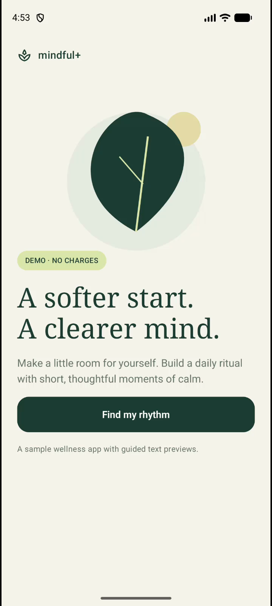<br><sub>Discover the client application</sub></td>
<td width="220" valign="top">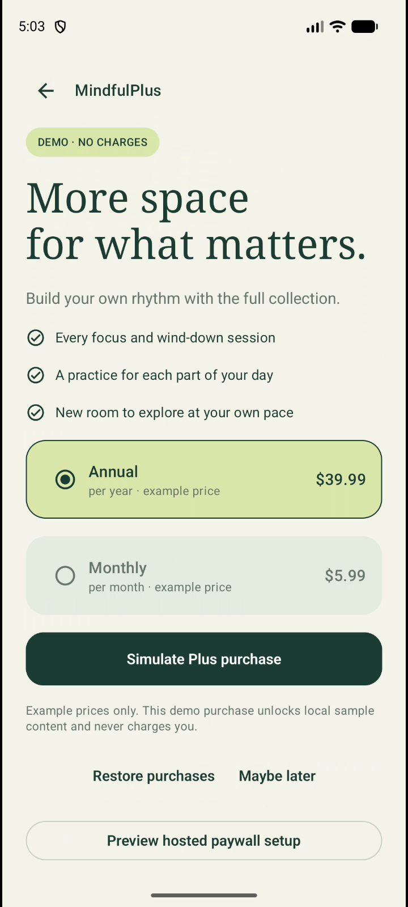<br><sub>Offer an upgrade at an access gate</sub></td>
<td width="220" valign="top">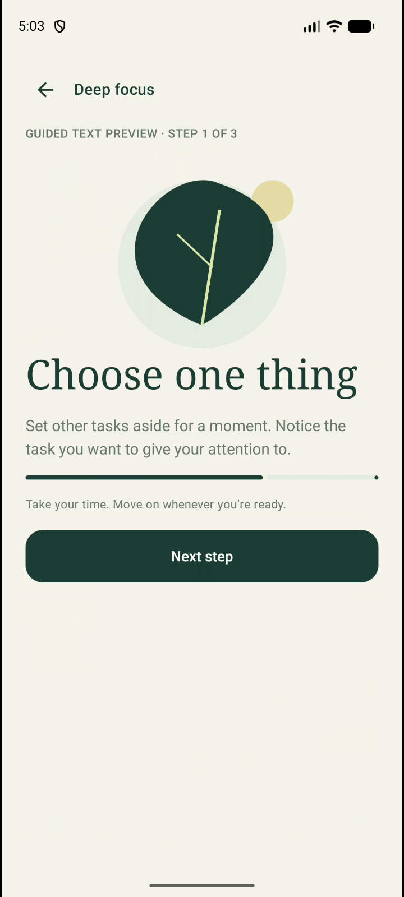<br><sub>Resume the requested premium preview</sub></td>
</tr></table>

### How the SDK is connected to the client

The screens consume one `BillingRepository` contract. Both implementations expose `StateFlow<BillingState>`, so content gates, membership UI and navigation respond to the same state. The live implementation calls Purchases and embeds Purchases UI; the demo implementation supplies local fixtures for repeatable walkthroughs.

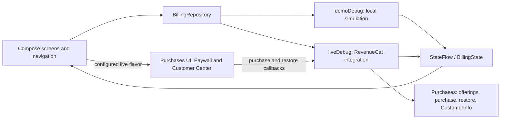

**The central rule:** merchandising comes from offerings and packages; content access comes from the configured entitlement. The app does not unlock Plus merely because a checkout action finished. Live purchase/restore results and customer updates are mapped through `acceptCustomerInfo` and `AccessPolicy`.

The live source also handles user cancellation, pending payment and errors; those real-store outcomes are implemented but are not demonstrated by the local screenshots.

| Journey | SDK capability or client responsibility |
| --- | --- |
| [01 · Onboarding and a personal intention](#journey-01-onboarding-and-a-personal-intention) | Client onboarding; initialize the live SDK once |
| [02 · A free preview leads to an optional paywall](#journey-02-a-free-preview-leads-to-an-optional-paywall) | Entitlement policy; optional post-completion paywall |
| [03 · Free content remains available in the library](#journey-03-free-content-remains-available-in-the-library) | Free versus Plus access in the library |
| [04 · Unlock Plus and resume the requested session](#journey-04-unlock-plus-and-resume-the-requested-session) | Packages → purchase result → entitlement → resume |
| [05 · Monthly selection and a simulated plan change](#journey-05-monthly-selection-and-a-simulated-plan-change) | Subscription product/base-plan replacement intent |
| [06 · An entitled member completes premium content](#journey-06-an-entitled-member-completes-premium-content) | Active access; suppress upgrade prompts for members |
| [07 · Restore with and without an existing purchase](#journey-07-restore-with-and-without-an-existing-purchase) | Restore result and exact-entitlement validation |
| [08 · Customer Center and subscription-management entry points](#journey-08-customer-center-and-subscription-management-entry-points) | Customer Center and store-management integration |
| [09 · Hosted paywall setup and policy placeholders](#journey-09-hosted-paywall-setup-and-policy-placeholders) | Hosted Paywall wiring and app policy URLs |
| [10 · Inspect customer state, offerings, products and balances](#journey-10-inspect-customer-state-offerings-products-and-balances) | CustomerInfo, offerings, products, currencies, events |
| [11 · Customer identity, attributes and logout](#journey-11-customer-identity-attributes-and-logout) | Identity, attributes, targeting synchronization |
| [12 · Revoke access while premium content is open](#journey-12-revoke-access-while-premium-content-is-open) | Reactive access updates on an open destination |
| [13 · Progress survives Activity recreation](#journey-13-progress-survives-activity-recreation) | Android lifecycle and local journey persistence |
| [14 · Confirm restart and clear local demo progress](#journey-14-confirm-restart-and-clear-local-demo-progress) | Scoped local reset with confirmation |
| [15 · Back navigation, abandonment and voluntary upgrade](#journey-15-back-navigation-abandonment-and-voluntary-upgrade) | Paywall Back handling and voluntary upgrade |
| [16 · Unconfigured live mode keeps free content usable](#journey-16-unconfigured-live-mode-keeps-free-content-usable) | Live configuration validation and disabled actions |

Expand a journey for its screenshots, result, significance and implementation links. All four previews and every destination in the sample are covered.

### Journey 01: Onboarding and a personal intention

<details open>
<summary>Welcome → choose an intention → review the plan → Today → library</summary>

**Mode:** local demo; billing and customer data are simulated.

<table>
<tr>
<td width="220" valign="top"><br><sub>Welcome · local demo</sub></td>
<td width="220" valign="top">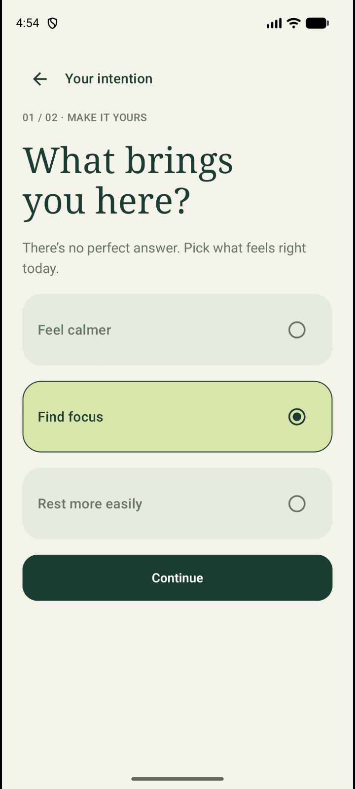<br><sub>Choose an intention</sub></td>
<td width="220" valign="top">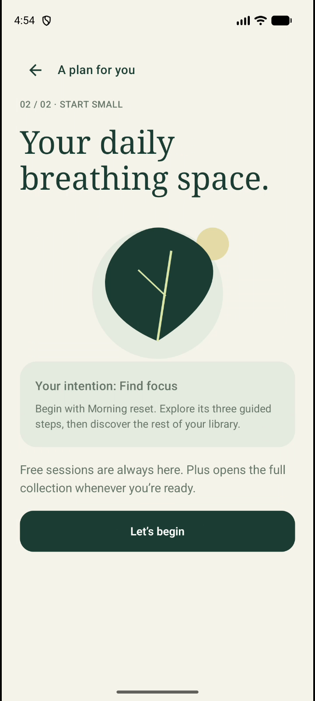<br><sub>Review the personal plan</sub></td>
</tr>
</table>

**Result:** All three intentions can be selected, and the plan reflects the choice. Onboarding and the goal are saved locally.

**Why it matters:** The purchase experience sits inside a complete client journey. Free onboarding and discovery are available before an upgrade decision.

**SDK connection:** Application-owned flow. The live flavor configures Purchases once in MindfulApplication; onboarding is not a RevenueCat API.

**Inspect the implementation:** [AppViewModel](app/src/main/java/com/example/mindfulplus/AppViewModel.kt) · [MindfulApplication](app/src/main/java/com/example/mindfulplus/MindfulApplication.kt) · [Screens](app/src/main/java/com/example/mindfulplus/ui/Screens.kt)

</details>

### Journey 02: A free preview leads to an optional paywall

<details open>
<summary>Morning reset → three guided steps → custom paywall → Maybe later → completion → Progress</summary>

**Mode:** local demo; billing and customer data are simulated.

<table>
<tr>
<td width="220" valign="top">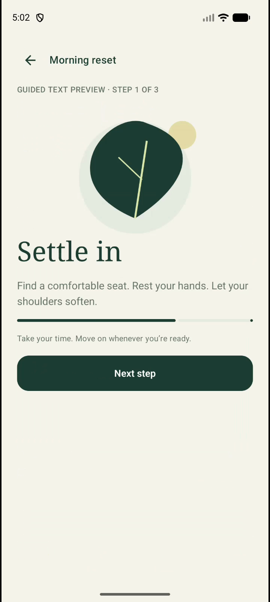<br><sub>Start a free preview</sub></td>
<td width="220" valign="top"><br><sub>Optional custom paywall · demo prices</sub></td>
<td width="220" valign="top"><br><sub>One preview saved after dismissal</sub></td>
</tr>
</table>

**Result:** Completing a free preview opens the upgrade prompt. Dismissing it preserves the completion and records one preview.

**Why it matters:** Upsell timing follows the application’s access policy. The customer can decline the upgrade and continue using free content.

**SDK connection:** Live access is derived from CustomerInfo.entitlements.active[requiredId]. AccessPolicy.shouldOfferUpgrade controls the prompt; awaitOfferings supplies real packages and store prices in live mode.

**Inspect the implementation:** [AccessPolicy](app/src/main/java/com/example/mindfulplus/billing/AccessPolicy.kt) · [MindfulApp](app/src/main/java/com/example/mindfulplus/ui/MindfulApp.kt) · [RevenueCatBillingRepository](app/src/main/java/com/example/mindfulplus/billing/RevenueCatBillingRepository.kt)

</details>

### Journey 03: Free content remains available in the library

<details>
<summary>Explore → A moment of quiet → finish → dismiss the upgrade → Today</summary>

**Mode:** local demo; billing and customer data are simulated.

<table>
<tr>
<td width="220" valign="top">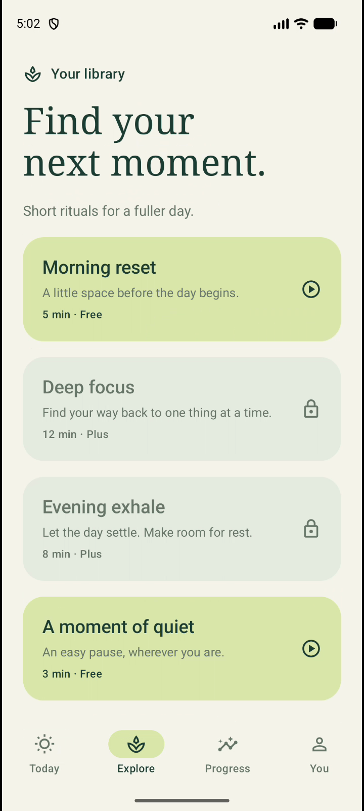<br><sub>Library · free and Plus previews</sub></td>
<td width="220" valign="top">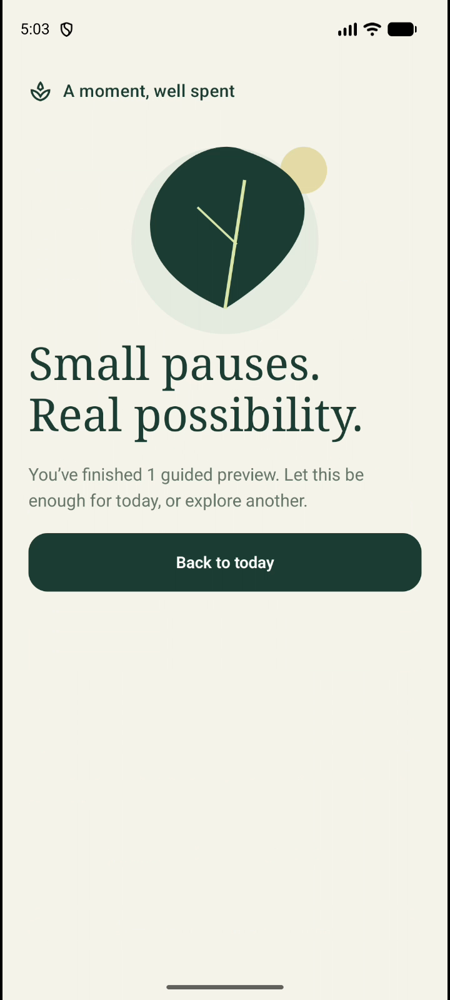<br><sub>Free completion remains accessible</sub></td>
</tr>
</table>

**Result:** The second free preview can be completed without a membership. Both free and Plus previews are visible in the same library.

**Why it matters:** Merchandising does not remove the free path. The content gate checks the session’s access requirement before navigation.

**SDK connection:** Application navigation and content policy; the live premium flag comes from the configured RevenueCat entitlement.

**Inspect the implementation:** [MindfulApp](app/src/main/java/com/example/mindfulplus/ui/MindfulApp.kt) · [Screens](app/src/main/java/com/example/mindfulplus/ui/Screens.kt) · [AccessPolicy](app/src/main/java/com/example/mindfulplus/billing/AccessPolicy.kt)

</details>

### Journey 04: Unlock Plus and resume the requested session

<details open>
<summary>Request locked Deep focus → select Annual → simulate purchase → resume Deep focus → finish → account</summary>

**Mode:** local demo; billing and customer data are simulated.

<table>
<tr>
<td width="220" valign="top"><br><sub>Annual upgrade prompt · local demo</sub></td>
<td width="220" valign="top"><br><sub>Resume the requested Deep focus preview</sub></td>
<td width="220" valign="top"><br><sub>Annual demo membership</sub></td>
</tr>
</table>

**Result:** The requested session is remembered while the paywall is open. Simulated Plus access unlocks it, and the account shows an Annual demo membership.

**Why it matters:** Checkout returns the customer to their original intent. In live mode, access follows the configured entitlement in the purchase result.

**SDK connection:** awaitOfferings → Package → PurchaseParams.Builder(activity, rcPackage) → awaitPurchase → result.customerInfo → entitlement check. pendingSession and Compose navigation resume the requested preview.

**Inspect the implementation:** [RevenueCatBillingRepository](app/src/main/java/com/example/mindfulplus/billing/RevenueCatBillingRepository.kt) · [MindfulApp](app/src/main/java/com/example/mindfulplus/ui/MindfulApp.kt) · [BillingScreens](app/src/main/java/com/example/mindfulplus/ui/BillingScreens.kt)

</details>

### Journey 05: Monthly selection and a simulated plan change

<details>
<summary>You → Discover Plus → Monthly → simulate purchase → membership plans → Annual → return to account</summary>

**Mode:** local demo; billing and customer data are simulated.

<table>
<tr>
<td width="220" valign="top">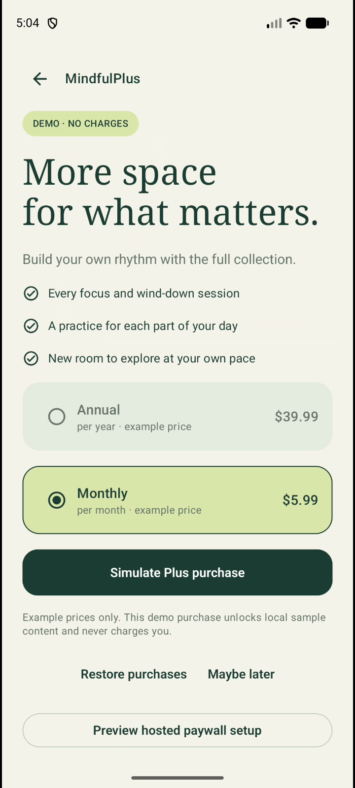<br><sub>Select Monthly · example price</sub></td>
<td width="220" valign="top"><br><sub>Monthly demo membership</sub></td>
<td width="220" valign="top"><br><sub>Annual summary after the simulated change</sub></td>
</tr>
</table>

**Result:** The selected plan is reflected in the local membership summary. An existing member can explore another plan.

**Why it matters:** An existing-subscription change needs product and base-plan awareness. A local selection example cannot establish store proration or replacement timing.

**SDK connection:** Live purchase uses PurchaseParams.oldProductId and replacementMode(StoreReplacementMode.WITHOUT_PRORATION) when the Play product or base plan changes. AccessPolicy.shouldReplaceSubscription covers both comparisons.

**Inspect the implementation:** [AccessPolicy](app/src/main/java/com/example/mindfulplus/billing/AccessPolicy.kt) · [RevenueCatBillingRepository](app/src/main/java/com/example/mindfulplus/billing/RevenueCatBillingRepository.kt) · [BillingScreens](app/src/main/java/com/example/mindfulplus/ui/BillingScreens.kt)

</details>

### Journey 06: An entitled member completes premium content

<details>
<summary>Existing Plus fixture → Evening exhale → finish → completion → Progress</summary>

**Mode:** local demo; billing and customer data are simulated.

<table>
<tr>
<td width="220" valign="top">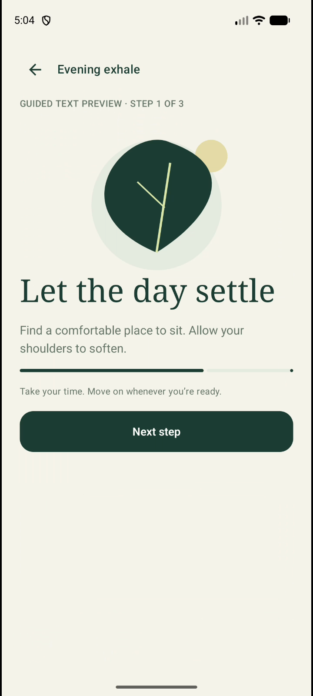<br><sub>Evening exhale with a Plus fixture</sub></td>
<td width="220" valign="top">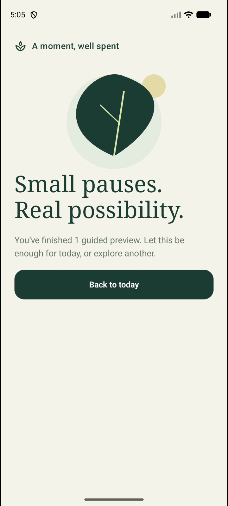<br><sub>Member completion without an upsell</sub></td>
</tr>
</table>

**Result:** Premium content opens directly, and completion does not show an upgrade prompt.

**Why it matters:** The same access state drives both content availability and upsell suppression. Membership changes should affect the experience consistently.

**SDK connection:** Live CustomerInfo entitlement mapping supplies premium. The UI gate and AccessPolicy.shouldOfferUpgrade consume that state.

**Inspect the implementation:** [RevenueCatBillingRepository](app/src/main/java/com/example/mindfulplus/billing/RevenueCatBillingRepository.kt) · [AccessPolicy](app/src/main/java/com/example/mindfulplus/billing/AccessPolicy.kt) · [MindfulApp](app/src/main/java/com/example/mindfulplus/ui/MindfulApp.kt)

</details>

### Journey 07: Restore with and without an existing purchase

<details>
<summary>Free account → Restore → simulate a purchase → Restore again → membership</summary>

**Mode:** local demo; billing and customer data are simulated.

<table>
<tr>
<td width="220" valign="top"><br><sub>Restore entry point · no demo purchase</sub></td>
<td width="220" valign="top">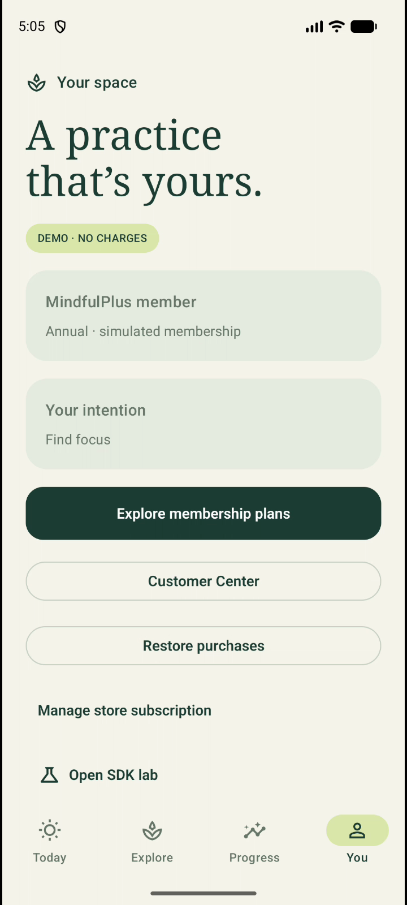<br><sub>Restored local demo membership</sub></td>
</tr>
</table>

**Result:** The first local restore leaves the account free. After a simulated purchase, restore reads the stored demo entitlement and the member state remains active.

**Why it matters:** A completed restore operation does not necessarily grant the entitlement the application needs. The UI must inspect the resulting access state.

**SDK connection:** Live awaitRestore returns CustomerInfo, which is passed through acceptCustomerInfo and the exact-entitlement policy.

**Inspect the implementation:** [RevenueCatBillingRepository](app/src/main/java/com/example/mindfulplus/billing/RevenueCatBillingRepository.kt) · [DemoBillingRepository](app/src/main/java/com/example/mindfulplus/billing/DemoBillingRepository.kt) · [Screens](app/src/main/java/com/example/mindfulplus/ui/Screens.kt)

</details>

### Journey 08: Customer Center and subscription-management entry points

<details>
<summary>Plus account fixture → Customer Center → restore demo purchase → account → manage store subscription</summary>

**Mode:** local demo; billing and customer data are simulated.

<table>
<tr>
<td width="220" valign="top">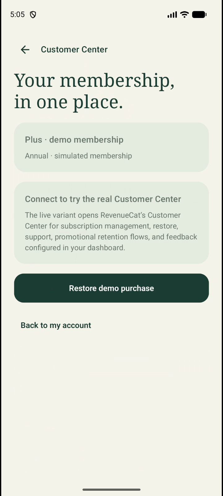<br><sub>Demo setup explanation · not the SDK Customer Center</sub></td>
<td width="220" valign="top"><br><sub>Account management entry points</sub></td>
</tr>
</table>

**Result:** The demo explains where subscription management belongs and offers a local restore. It has no store subscription page.

**Why it matters:** Purchase integration includes recovery and post-purchase support. The application provides account entry points for those capabilities.

**SDK connection:** The configured live route renders CustomerCenter with CustomerCenterOptions and CustomerCenterListener. Store management uses awaitShowManageSubscriptions(context).

**Inspect the implementation:** [BillingScreens](app/src/main/java/com/example/mindfulplus/ui/BillingScreens.kt) · [Screens](app/src/main/java/com/example/mindfulplus/ui/Screens.kt) · [RevenueCatBillingRepository](app/src/main/java/com/example/mindfulplus/billing/RevenueCatBillingRepository.kt)

</details>

### Journey 09: Hosted paywall setup and policy placeholders

<details>
<summary>Custom paywall → hosted setup explanation → return → Terms / Privacy</summary>

**Mode:** local demo; billing and customer data are simulated.

<table>
<tr>
<td width="220" valign="top">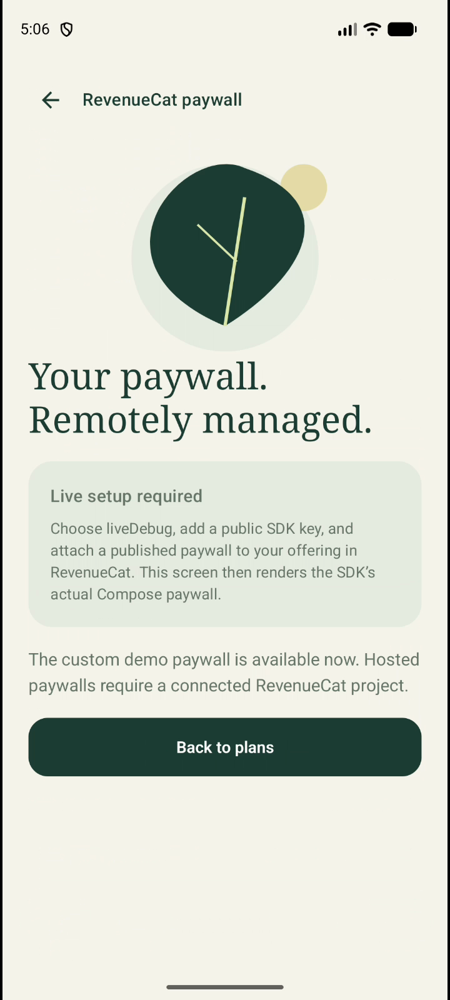<br><sub>Hosted paywall setup · app-owned explanation</sub></td>
<td width="220" valign="top">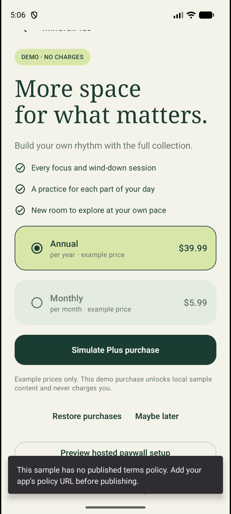<br><sub>Missing Terms policy URL explained</sub></td>
</tr>
</table>

**Result:** The demo shows the setup needed to render a hosted RevenueCat paywall. Missing policy URLs are explained in the client.

**Why it matters:** A custom paywall and the SDK-rendered paywall share the membership state, but the hosted experience also needs dashboard configuration. Published app policies are an application responsibility.

**SDK connection:** The configured live branch uses Paywall(PaywallOptions), setOffering and PaywallListener purchase/restore callbacks. Demo shows a setup placeholder; the real renderer was not exercised.

**Inspect the implementation:** [BillingScreens](app/src/main/java/com/example/mindfulplus/ui/BillingScreens.kt) · [MindfulApp](app/src/main/java/com/example/mindfulplus/ui/MindfulApp.kt)

</details>

### Journey 10: Inspect customer state, offerings, products and balances

<details open>
<summary>SDK lab → refresh → availability → sample offering / metadata → currencies → product lookup → event history</summary>

**Mode:** local demo; billing and customer data are simulated.

<table>
<tr>
<td width="220" valign="top">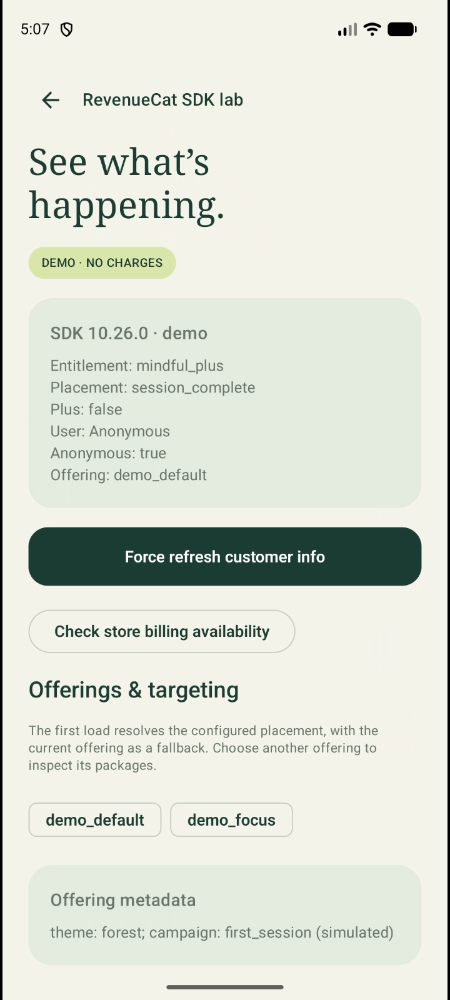<br><sub>SDK lab · local state and controls</sub></td>
<td width="220" valign="top">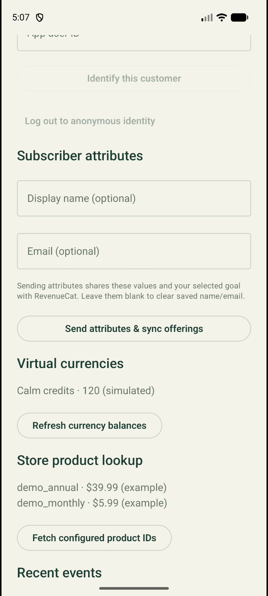<br><sub>Sample products and currency balance</sub></td>
<td width="220" valign="top">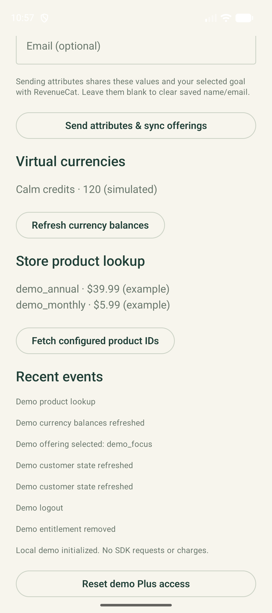<br><sub>Recent local operation events</sub></td>
</tr>
</table>

**Result:** The lab exposes the integration’s state and recent operations. The captured offerings, prices and Calm credits are local sample data.

**Why it matters:** Support and debugging benefit from inspectable customer, merchandising and product state. Balance retrieval is separate from spending currency.

**SDK connection:** The live repository wires awaitCustomerInfo, invalidateCustomerInfoCache, CacheFetchPolicy, awaitCanMakePayments, awaitOfferings, awaitGetProducts, awaitGetVirtualCurrencies and invalidateVirtualCurrenciesCache.

**Inspect the implementation:** [SdkLabScreen](app/src/main/java/com/example/mindfulplus/ui/SdkLabScreen.kt) · [RevenueCatBillingRepository](app/src/main/java/com/example/mindfulplus/billing/RevenueCatBillingRepository.kt) · [DemoBillingRepository](app/src/main/java/com/example/mindfulplus/billing/DemoBillingRepository.kt)

</details>

### Journey 11: Customer identity, attributes and logout

<details>
<summary>Synthetic App User ID → cancel confirmation once → identify → synthetic name / email → sync simulation → anonymous identity</summary>

**Mode:** local demo; billing and customer data are simulated.

<table>
<tr>
<td width="220" valign="top">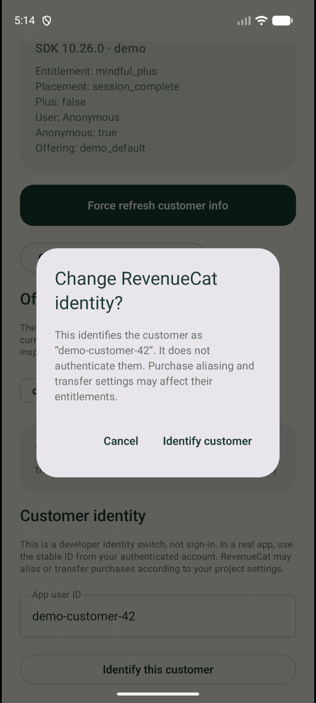<br><sub>Confirm the synthetic customer identity</sub></td>
<td width="220" valign="top">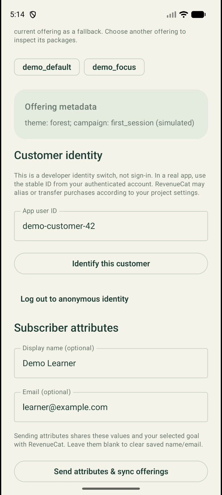<br><sub>Synthetic attributes · nothing transmitted</sub></td>
<td width="220" valign="top">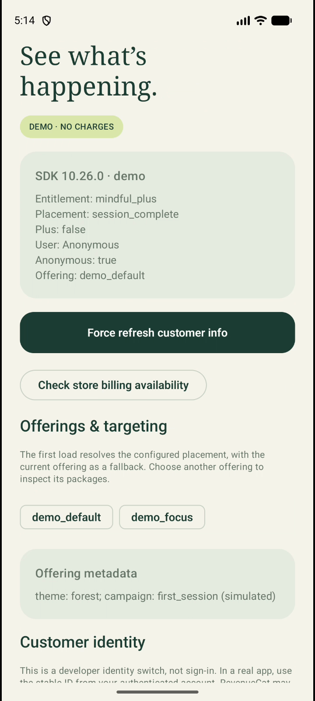<br><sub>Return to the anonymous demo identity</sub></td>
</tr>
</table>

**Result:** The identity change is confirmed explicitly. Synthetic attributes are entered, and logout returns the local identity to anonymous.

**Why it matters:** RevenueCat identity must be coordinated with an application’s authentication system. Selecting an SDK user ID does not authenticate a person or prove purchase ownership.

**SDK connection:** The live path uses awaitLogIn / awaitLogOut, setDisplayName, setEmail, setAttributes and awaitSyncAttributesAndOfferingsIfNeeded. The demo sends nothing to RevenueCat.

**Inspect the implementation:** [SdkLabScreen](app/src/main/java/com/example/mindfulplus/ui/SdkLabScreen.kt) · [RevenueCatBillingRepository](app/src/main/java/com/example/mindfulplus/billing/RevenueCatBillingRepository.kt) · [DemoBillingRepository](app/src/main/java/com/example/mindfulplus/billing/DemoBillingRepository.kt)

</details>

### Journey 12: Revoke access while premium content is open

<details open>
<summary>Plus fixture → open Deep focus → inject local revocation → locked screen → re-unlock → SDK lab reset → gated library</summary>

**Mode:** local demo; billing and customer data are simulated.

<table>
<tr>
<td width="220" valign="top">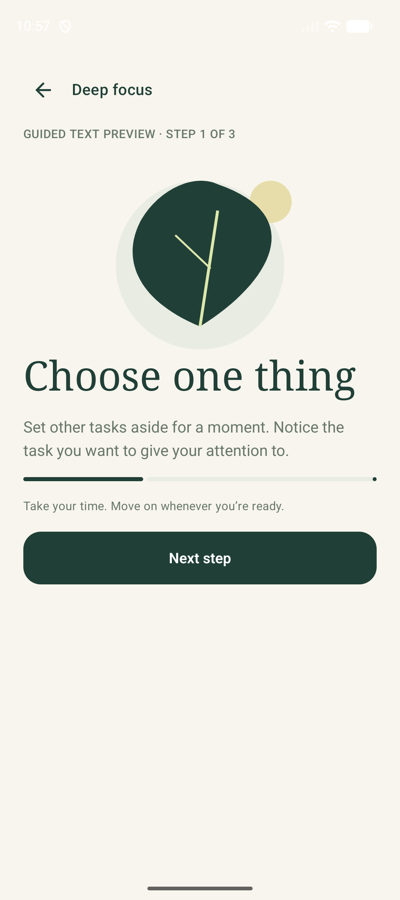<br><sub>Before · premium preview is open</sub></td>
<td width="220" valign="top">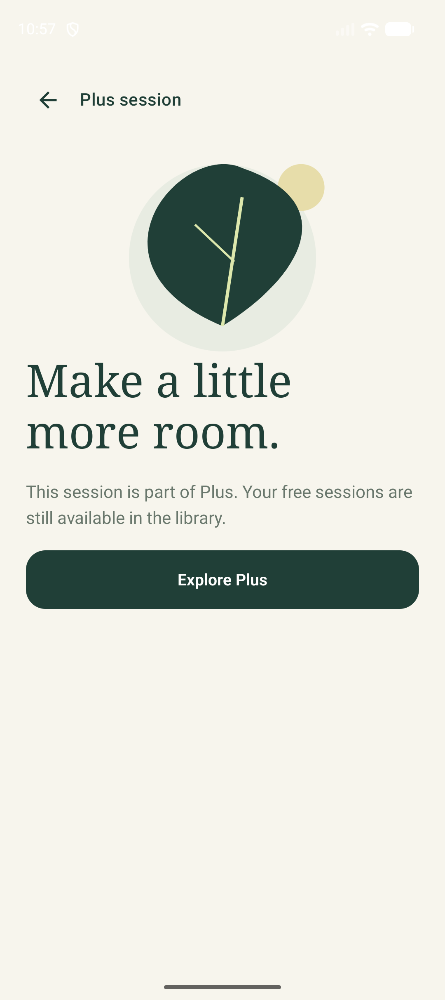<br><sub>After · locked by a local revocation test injection</sub></td>
</tr>
</table>

**Result:** The already-open premium destination switches to its locked state as soon as the demo entitlement is removed. The visible SDK lab reset also revokes local access.

**Why it matters:** Access is evaluated while content is displayed, not only at navigation time. A customer-state change can invalidate a previously allowed destination.

**SDK connection:** Live updatedCustomerInfoListener and awaitCustomerInfo update the repository state; acceptCustomerInfo maps the exact entitlement. The Compose route rechecks premium while open. The capture uses a labeled test injection, not a real backend revocation.

**Inspect the implementation:** [MindfulApp](app/src/main/java/com/example/mindfulplus/ui/MindfulApp.kt) · [RevenueCatBillingRepository](app/src/main/java/com/example/mindfulplus/billing/RevenueCatBillingRepository.kt) · [AccessPolicy](app/src/main/java/com/example/mindfulplus/billing/AccessPolicy.kt)

</details>

### Journey 13: Progress survives Activity recreation

<details>
<summary>Plus fixture → complete two previews → Progress → recreate Activity → Progress / account</summary>

**Mode:** local demo; billing and customer data are simulated.

<table>
<tr>
<td width="220" valign="top"><br><sub>Two previews before recreation</sub></td>
<td width="220" valign="top">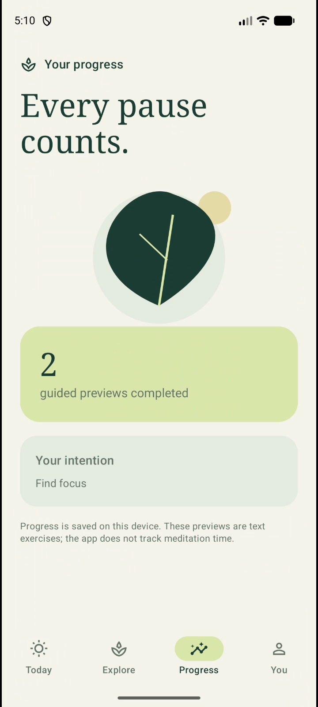<br><sub>Two previews after Activity recreation</sub></td>
</tr>
</table>

**Result:** The count remains two, onboarding is skipped, and the in-memory demo membership remains visible after Activity recreation.

**Why it matters:** Android lifecycle behavior must preserve the client’s journey independently of purchase UI. This recording demonstrates Activity recreation, not process death or reinstall recovery.

**SDK connection:** Local SharedPreferences and AppViewModel persist onboarding and progress. Live customer refresh on resume is wired in MainActivity; RevenueCat identity/customer caching is separate from local practice progress.

**Inspect the implementation:** [AppViewModel](app/src/main/java/com/example/mindfulplus/AppViewModel.kt) · [MainActivity](app/src/main/java/com/example/mindfulplus/MainActivity.kt) · [DemoBillingRepository](app/src/main/java/com/example/mindfulplus/billing/DemoBillingRepository.kt)

</details>

### Journey 14: Confirm restart and clear local demo progress

<details>
<summary>Three-preview fixture → SDK lab → cancel restart → confirm restart → onboarding → Progress</summary>

**Mode:** local demo; billing and customer data are simulated.

<table>
<tr>
<td width="220" valign="top">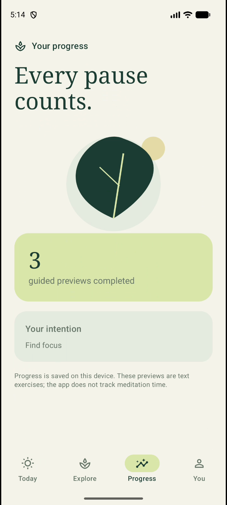<br><sub>Before · prepared count of three</sub></td>
<td width="220" valign="top">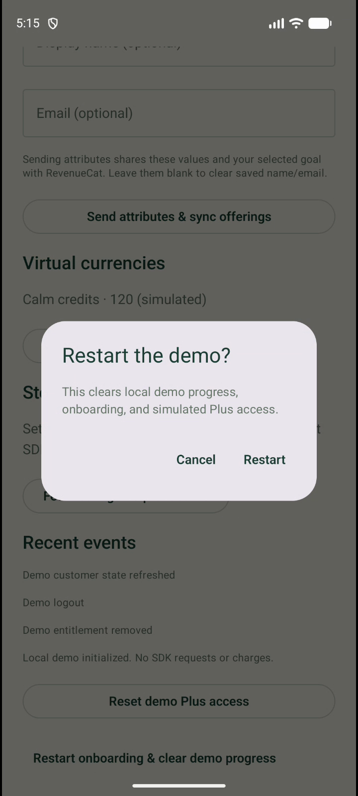<br><sub>Confirm the local demo reset</sub></td>
<td width="220" valign="top"><br><sub>After · zero completed previews</sub></td>
</tr>
</table>

**Result:** The prepared count changes from three to zero after the restart is confirmed. The user sees what will be cleared before deciding.

**Why it matters:** Destructive local demo operations need an explicit confirmation and a clear scope. Resetting the sample is not subscription cancellation or RevenueCat account deletion.

**SDK connection:** Application-only AppViewModel.resetJourney plus DemoBillingRepository.resetDemo. No RevenueCat account or store transaction is changed.

**Inspect the implementation:** [AppViewModel](app/src/main/java/com/example/mindfulplus/AppViewModel.kt) · [SdkLabScreen](app/src/main/java/com/example/mindfulplus/ui/SdkLabScreen.kt) · [DemoBillingRepository](app/src/main/java/com/example/mindfulplus/billing/DemoBillingRepository.kt)

</details>

### Journey 15: Back navigation, abandonment and voluntary upgrade

<details>
<summary>Open free preview → Back → premium gate → Android Back → Progress → Today → voluntary Plus prompt</summary>

**Mode:** local demo; billing and customer data are simulated.

<table>
<tr>
<td width="220" valign="top">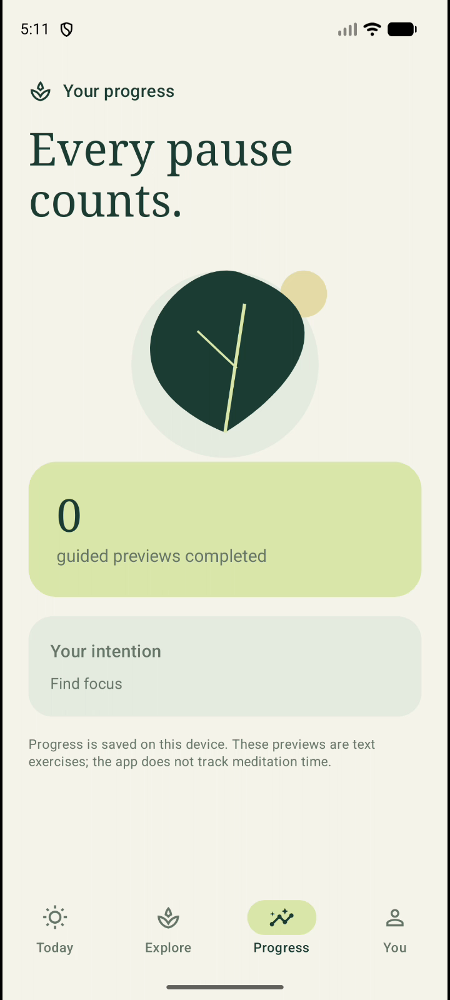<br><sub>No completion recorded after abandonment</sub></td>
<td width="220" valign="top">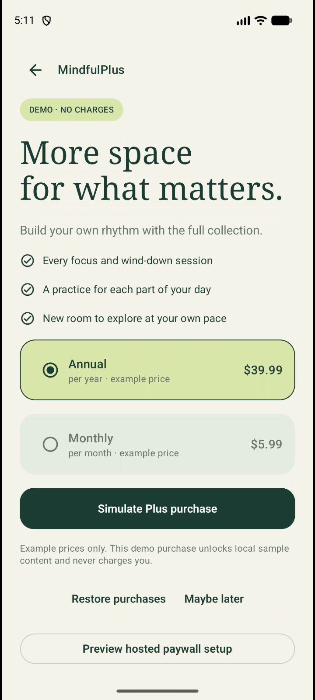<br><sub>Voluntary upgrade from Today</sub></td>
</tr>
</table>

**Result:** An unfinished preview does not increase progress. Back dismisses the app’s paywall, and the customer can also open it voluntarily from Today.

**Why it matters:** Checkout entry and exit should fit the client’s navigation. Leaving the app’s custom paywall is distinct from cancelling a transaction in a real store checkout.

**SDK connection:** Compose Navigation and BackHandler own the flow. RevenueCat supplies live packages and access state; the application controls navigation and completion counting.

**Inspect the implementation:** [MindfulApp](app/src/main/java/com/example/mindfulplus/ui/MindfulApp.kt) · [AppViewModel](app/src/main/java/com/example/mindfulplus/AppViewModel.kt) · [Screens](app/src/main/java/com/example/mindfulplus/ui/Screens.kt)

</details>

### Journey 16: Unconfigured live mode keeps free content usable

<details open>
<summary>Live build without a key → onboarding → free preview → disabled checkout → SDK lab configuration message</summary>

**Mode:** liveDebug without an SDK key.

<table>
<tr>
<td width="220" valign="top">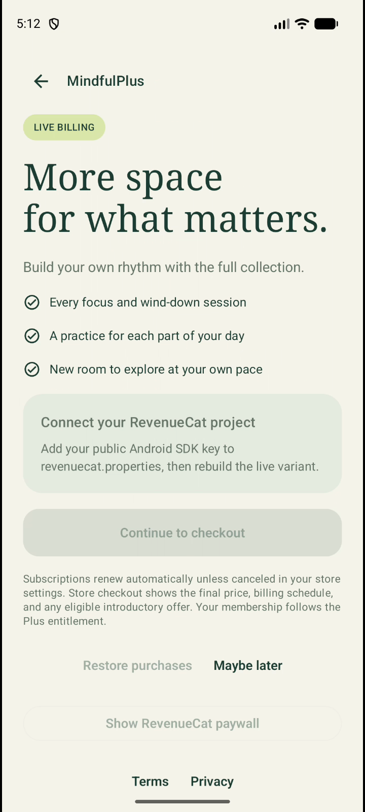<br><sub>LIVE / no key · checkout disabled</sub></td>
<td width="220" valign="top">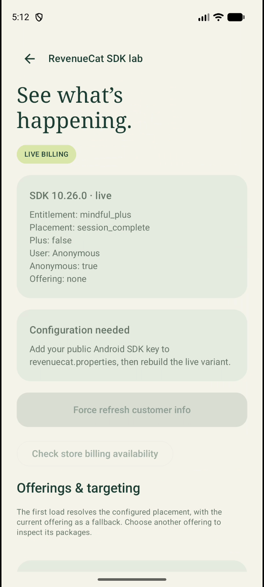<br><sub>LIVE / no key · SDK actions disabled</sub></td>
</tr>
</table>

**Result:** The live flavor explains the missing public SDK key and disables billing actions. Free content and completion remain usable.

**Why it matters:** Configuration errors should not trigger an unconfigured singleton or turn the live build into an unlabeled simulation.

**SDK connection:** MindfulApplication validates configuration before Purchases.configure. The configured flag guards repository operations and purchase controls. No live transaction or RevenueCat request is demonstrated by these captures.

**Inspect the implementation:** [MindfulApplication](app/src/main/java/com/example/mindfulplus/MindfulApplication.kt) · [AccessPolicy](app/src/main/java/com/example/mindfulplus/billing/AccessPolicy.kt) · [RevenueCatBillingRepository](app/src/main/java/com/example/mindfulplus/billing/RevenueCatBillingRepository.kt) · [BillingScreens](app/src/main/java/com/example/mindfulplus/ui/BillingScreens.kt)

</details>

### What these images verify

The screenshots show the real Compose client UI from the Android 17 emulator walkthroughs. The original 16 recorded journeys passed their application-level assertions, including the premium gate, return after unlock, restore state, access revocation, Activity recreation and missing-key checkout guard. Screenshots are review evidence for those client flows; they do not establish successful live store or backend transactions.

Some journeys begin with prepared Plus/progress fixtures. Journey 12 deliberately injects local entitlement revocation. Journey 13 tests Activity recreation, not process death or reinstall. Journey 14 starts with a prepared count of three and confirms that it resets to zero. The demo identity switch does not model authenticated accounts, aliasing, or separate purchase ownership.

To exercise the actual SDK/backend, configure RevenueCat Test Store first; then validate Google Play behavior with the appropriate store products and test account. Published hosted paywalls, live Customer Center, remote targeting, real virtual-currency balances, renewal, pending recovery, plan-change billing and account transfers need that additional configuration and verification.

See the [Android SDK study guide](docs/RevenueCat-Android-SDK-study-guide.md) for API contracts and the real-store test matrix. [Capture provenance](docs/screenshots/capture-manifest.json) records the journey, image mode and source capture for every screenshot.

## Run it now

Open the repository directory in Android Studio. Select the **demoDebug** build variant and run `app`. It needs no RevenueCat account or API key. The application ID is `com.example.mindfulplus.demo`, so demo and live can coexist.

Walkthrough:

1. Tap **Find my rhythm**, choose an intention, and complete onboarding.
2. On Today, open **Morning reset**, advance through its three guided text steps, and finish the session.
3. The Plus paywall appears. **Maybe later** keeps free content usable. **Simulate Plus purchase** grants local demo access with no store transaction or charge.
4. Explore includes two free previews and two premium previews. Opening a locked preview offers Plus; unlocking returns you to the requested preview.
5. Progress persists the number of completed previews on this device.
6. You includes membership details, restore, Customer Center, store management, and the SDK lab.
7. In the SDK lab, reset demo access or restart the complete journey.

These are text previews with original Compose vector artwork. The sample has no audio playback, clinical guidance, backend authentication, or remote content service.

## Connect actual RevenueCat billing

Copy `revenuecat.properties.example` to the ignored `revenuecat.properties` file in the project root. Populate it with a **public Android SDK key** and your exact entitlement ID. Never use a secret `sk_` API key.

```properties
publicSdkKey=test_YOUR_PUBLIC_TEST_STORE_KEY
entitlementId=mindful_plus
placementId=session_complete
productIds=
privacyUrl=
termsUrl=
```

Then select **liveDebug**, sync Gradle, and run the app. The live application ID is `com.example.mindfulplus`; configure that package in Google Play if testing Google Play billing. To use your own package name, update `applicationId` in `app/build.gradle.kts` before registering store products.

For a first SDK test, use RevenueCat Test Store:

1. Create/select a RevenueCat project and its Test Store under Apps and providers.
2. Add monthly and annual Test Store products. Attach them to the `mindful_plus` entitlement (or the entitlement ID you configured).
3. Create an offering, add monthly/annual packages, and mark it current. Optionally configure the `session_complete` placement.
4. Copy that Test Store’s public `test_` key into the file above and run **liveDebug**. The actual SDK invokes the Test Store purchase modal and updates RevenueCat customer state.
5. Publish a paywall on the offering to try **Show RevenueCat paywall**. Configure Customer Center separately to try its real self-service flow.

Test Store uses simulated store outcomes backed by RevenueCat; the **demo** flavor is an entirely local simulation. Missing/invalid live configuration shows setup instructions and disables checkout. Live mode never substitutes demo prices or demo access.

For Google Play, use your public `goog_` key, connect Google Play to RevenueCat, create subscription products/base plans and packages, and test with the matching package and a configured license tester. Follow the official Google Play sandbox guide for installation and tester setup. Real store checkout can charge a real customer outside the sandbox.

Before distributing a real app, provide your app’s published privacy/terms URLs, your own package/branding, release signing, and authenticated account IDs. The live release path refuses to initialize Test Store keys. No store account, products, dashboard paywall, account credentials, or release-signing key is supplied in this project.

## SDK features and entry points

| Feature | Where to try it | Implementation |
| --- | --- | --- |
| Configure SDK once; public-key validation; debug logging | liveDebug launch | `MindfulApplication` |
| Offerings, packages, localized store prices | Custom Plus paywall | `awaitOfferings`, `PurchaseParams.Builder`, `awaitPurchase` |
| Placement targeting and current-offering fallback | First offerings load | `getCurrentOfferingForPlacement` |
| Offering inspection and metadata | SDK lab | All offerings and available packages |
| Fullscreen RevenueCat Compose paywall | Show RevenueCat paywall | `Paywall`, `PaywallOptions`, `PaywallListener` |
| Purchase, cancellation, pending payment, error handling | Store checkout | Coroutine transaction results and typed errors |
| Entitlement-gated content and return after upgrade | Premium library sessions | Exact configured entitlement from `CustomerInfo` |
| Automatic customer updates and foreground refresh | Membership screen | `UpdatedCustomerInfoListener`, lifecycle resume |
| Restore without assuming access was granted | Paywall or account | `awaitRestore` and fresh entitlement check |
| Google Play plan replacement, including same-product base plans | Membership plans | Old product ID, `WITHOUT_PRORATION` replacement mode |
| Anonymous and identified customers, log in/out | SDK lab | `awaitLogIn`, `awaitLogOut`; this is not authentication |
| Name, email, goal attributes and targeting sync | SDK lab | `setDisplayName`, `setEmail`, `setAttributes`, attribute/offering sync |
| Direct store product lookup | SDK lab | `awaitGetProducts` using configured product IDs |
| Store billing availability | SDK lab | `awaitCanMakePayments` |
| Entitlements, subscriptions, expiry, renewal, billing issue, sandbox status | Account and SDK lab | `CustomerInfo`, `EntitlementInfo` |
| Virtual currency balances and cache invalidation | SDK lab | `awaitGetVirtualCurrencies`, currency cache refresh |
| Customer Center and restore/promotional/feedback/custom-action events | You → Customer Center | SDK Compose Customer Center and listener |
| Store subscription management | You | `awaitShowManageSubscriptions` |
| Paywall purchase/restore/control/link events | SDK lab event history | SDK listener callbacks |
| Forced customer refresh/cache invalidation | SDK lab | Fetch current policy and cache invalidation |

The custom paywall purchases the package’s default eligible subscription option; final introductory/trial terms are shown by checkout. The app does not promise a free trial. Hosted paywall behavior and retention promotions follow your RevenueCat configuration. Currency spending, webhooks, analytics dashboards, refunds, server integrations, and store-specific Amazon/Galaxy modules require separate configuration or backend work and are not implemented here.

## Build and test

Toolchain: Gradle 8.13, AGP 8.11.2, Kotlin/Compose compiler 2.3.10, Compose BOM 2025.08.01, compile/target SDK 36, minimum SDK 24, Java target 17. Android Studio’s bundled JBR 21 was used for validation. These compatible versions are intentionally pinned; RevenueCat is the latest release found when this sample was created. The official wrapper includes the distribution SHA-256 checksum.

```sh
./gradlew assembleDemoDebug assembleLiveDebug
./gradlew testDemoDebugUnitTest testLiveDebugUnitTest lintDemoDebug lintLiveDebug
./gradlew connectedDemoDebugAndroidTest connectedLiveDebugAndroidTest
```

The demo journey test checks onboarding, an automatic paywall after a free session, dismissal, a premium-content gate, simulated purchase, revocation while premium content is open, restore, progress, and a fresh Activity launch. The live setup test runs when the live key is blank and confirms checkout is disabled while free content remains available. Each flavor skips the other flavor’s instrumentation case. The tests also export demo PNG previews to the device’s external cache.

Unit coverage includes exact-entitlement matching, no-entitlement access, upgrade timing, public/secret key rules, debug-only Test Store keys, missing configuration, and product/base-plan replacement decisions.

See [the Android SDK study guide](docs/RevenueCat-Android-SDK-study-guide.md) for API contracts, source-reading pointers, and verification limits. SDK-backed checkout, hosted paywalls, and Customer Center require a configured key/dashboard and were not transaction-tested without one.

## Source map

- [billing/RevenueCatBillingRepository.kt](app/src/main/java/com/example/mindfulplus/billing/RevenueCatBillingRepository.kt): real SDK calls, customer state, concurrency/error handling.
- [billing/DemoBillingRepository.kt](app/src/main/java/com/example/mindfulplus/billing/DemoBillingRepository.kt): isolated local simulation.
- [billing/AccessPolicy.kt](app/src/main/java/com/example/mindfulplus/billing/AccessPolicy.kt): access/configuration/replacement rules.
- [AppViewModel.kt](app/src/main/java/com/example/mindfulplus/AppViewModel.kt): local onboarding and practice progress.
- [ui/MindfulApp.kt](app/src/main/java/com/example/mindfulplus/ui/MindfulApp.kt): navigation, premium gates, return after purchase.
- [ui/BillingScreens.kt](app/src/main/java/com/example/mindfulplus/ui/BillingScreens.kt): custom/hosted paywalls and Customer Center.
- [ui/SdkLabScreen.kt](app/src/main/java/com/example/mindfulplus/ui/SdkLabScreen.kt): SDK exploration tools.

## Official references checked

- [RevenueCat Android SDK on GitHub](https://github.com/RevenueCat/purchases-android)
- [SDK 10.26.0 release](https://github.com/RevenueCat/purchases-android/releases/tag/10.26.0)
- [Android installation](https://www.revenuecat.com/docs/getting-started/installation/android)
- [Displaying paywalls](https://www.revenuecat.com/docs/tools/paywalls/displaying-paywalls)
- [Customer Center for Android](https://www.revenuecat.com/docs/tools/customer-center/customer-center-integration-android)
- [RevenueCat Test Store](https://www.revenuecat.com/docs/test-and-launch/sandbox/test-store)
- [Google Play sandbox](https://www.revenuecat.com/docs/test-and-launch/sandbox/google-play)
- [Subscription management](https://www.revenuecat.com/docs/subscription-guidance/managing-subscriptions)
- [Virtual currencies](https://www.revenuecat.com/docs/offerings/virtual-currency)
- [AGP 8.11 compatibility](https://developer.android.com/build/releases/agp-8-11-0-release-notes)
